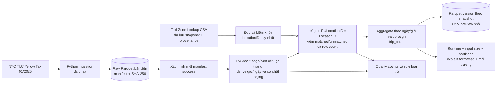

# Kiến trúc project Big Data

Trạng thái: Checkpoint 3 đã có `src/pipeline_tlc.py` và lookup snapshot; số liệu full run xem `reports/checkpoint3.md`. Các nhánh sau Checkpoint 3 là hướng phát triển, chưa triển khai.

## Hiện trạng có bằng chứng

`src/ingest_tlc.py` tải file Parquet Yellow Taxi 01/2025 qua module dùng chung `src/ingest_http.py`, lưu nguyên bytes vào một run mới cùng manifest. `src/inspect_raw.py` xác minh dung lượng/hash và Spark đọc được 3.475.226 dòng, 20 cột (`metadata/raw_inspection.json`). Có ba run thành công, cùng checksum; `data/sample/` chỉ có 1.000 dòng dẫn xuất và không đại diện thống kê. Spark 3.5.8 chạy local. Pipeline Checkpoint 3 có full run, join, Gold và baseline tại `evidence/checkpoint3/`.

## Dòng dữ liệu mục tiêu

Sơ đồ pipeline bên dưới mô tả luồng đã chạy; số liệu nguồn nằm trong `evidence/checkpoint3/`.

Hộp từ `VERIFY` trở đi đã được viết trong `src/pipeline_tlc.py`; trạng thái chạy thực tế được ghi ở báo cáo Checkpoint 3. Bảng Taxi Zone Lookup CSV được [TLC công bố trên trang Trip Record Data](https://www.nyc.gov/site/tlc/about/tlc-trip-record-data.page), bản sao tại `data/reference/taxi_zone_lookup.csv` và provenance tại `metadata/taxi_zone_lookup.json`. Không dùng `customers.csv` trong StarterKit làm dimension cho taxi.

## Hợp đồng dữ liệu

| Tập | Grain | Khóa và ràng buộc | Vai trò |
| --- | --- | --- | --- |
| Raw Yellow Taxi | Một bản ghi chuyến theo nguồn; nguồn không cung cấp trip ID duy nhất | `PULocationID` có thể thiếu/không khớp zone; không giả định toàn bộ bản ghi là duy nhất | Fact bất biến, chọn bằng manifest/hash |
| Taxi Zone Lookup | Một dòng trên `LocationID` | Phải kiểm tra `LocationID` không null và unique trước join | Dimension khu vực |
| Silver trip | Một dòng trên bản ghi chuyến đủ điều kiện phân tích | Giữ lineage tới raw snapshot; ghi lý do loại bỏ, tránh khử trùng theo các trường không chứng minh được là khóa | Input đã chuẩn hóa cho KPI |
| Gold pickup demand | Một dòng trên ngày địa phương × giờ đón × borough đón | Các cột nhóm không null hoặc nhóm Unknown có nhãn rõ | Trả lời nhu cầu theo thời gian/khu vực |

`tpep_pickup_datetime` là giờ đồng hồ đo bắt đầu. Spark đọc cột này thành `timestamp_ntz` (`logs/raw_inspection.txt`), nghĩa là giá trị không mang offset; **PENDING**: xác nhận quy ước timezone của nguồn trước khi gọi ngày/giờ dẫn xuất là giờ địa phương New York. Không tự chuyển từ UTC. Pipeline đang lọc `[2025-01-01, 2025-02-01)` theo giá trị pickup timestamp nguồn và đếm riêng bản ghi ngoài phạm vi. `trip_distance` là dặm theo đồng hồ; `total_amount` là tổng thu khách và không gồm tip tiền mặt theo [data dictionary của TLC](https://www.nyc.gov/assets/tlc/downloads/pdf/data_dictionary_trip_records_yellow.pdf). KPI chính là số chuyến; chỉ thêm chỉ số tiền sau khi chốt cách xử lý null và giá trị âm, không gọi là doanh thu ròng.

## Ranh giới và quy tắc chạy lại

1. Ingest tạo run raw mới, không ghi đè. Pipeline nhận **đường dẫn manifest** rõ ràng và tự kiểm tra status, hash, size trước khi xử lý.
2. Zone lookup có bản sao theo version/hash; fail nếu khóa dimension trùng. Left join giữ fact có mã khu vực không khớp; phân biệt `LocationID` có trong lookup nhưng zone/borough đặc biệt với key null hoặc không khớp. Nhóm báo cáo thiếu borough có nhãn rõ, kèm count theo từng nguyên nhân. `joined_rows` phải bằng `valid_trip_rows`; khác thì fail.
3. Output **VERIFIED** đặt dưới `data/processed/nyc_tlc_yellow/raw_<hash>_zone_<hash>_code_<hash>/gold.parquet`. PyArrow ghi file Gold đã aggregate trong Spark vì Hadoop writer trên Windows thiếu `winutils.exe`. Rerun cùng input/code có cùng SHA-256 Gold; không append hoặc ghi đè raw. Chưa cam kết thao tác thay thế output là nguyên tử trên Windows.
4. Quality report, baseline và execution plan đặt cùng version output hoặc `evidence/checkpoint3/`; ghi đầy đủ input hashes, code commit, lệnh và cấu hình. Runtime chỉ so sánh khi cùng input, máy và cấu hình.
5. Máy khác cần chạy setup, ingest lại hoặc cung cấp raw snapshot đúng hash; manifest cũ chứa `destination` tuyệt đối của máy tạo và có thể không dùng nguyên xi sau clone. Cần quy tắc resolve path được kiểm chứng trước khi tuyên bố clone rồi chạy ngay.

## Quyết định thiết kế

- Giữ Python/PySpark local và cấu trúc repo hiện tại để nâng cấp Checkpoint 2 theo chiều dọc.
- Dùng lookup zone chính thức làm join có ý nghĩa nghiệp vụ. Kiểm uniqueness và matched/unmatched là điều kiện nghiệm thu, không chỉ có lệnh `join`.
- Giữ baseline correctness trước khi tối ưu. Buổi 9–10 mới đánh giá repartition, broadcast, cache và skew theo số đo.
- Chưa chốt KPI hoặc ngưỡng loại trừ cuối cùng cho tới khi xem phân bố dữ liệu thực tế và nhận feedback giảng viên. Các lựa chọn trong `docs/checkpoint3_plan.md` là giả thuyết có điều kiện kiểm chứng.
